# Projet ZEN — Gestion de la scolarité et des paiements
## Dossier de conception UML — Code PlantUML

Ce fichier regroupe les diagrammes UML du projet dans un ordre logique : cas d’utilisation, classes, séquences, puis activités.

**Format :** PlantUML  
**Utilisation :** copier chaque bloc séparément dans PlantUML (extension `.puml`) ou dans un éditeur compatible.

> **Règle métier centrale :** les acteurs Administrateur et Étudiant doivent obligatoirement s’authentifier avant d’accéder aux fonctionnalités. Les fonctionnalités sont ensuite accessibles selon le rôle de l’utilisateur.

---

# 1. Diagramme de cas d’utilisation

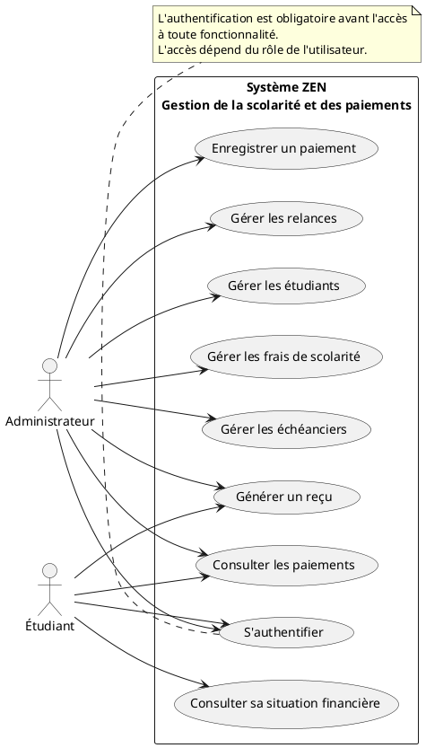

---

# 2. Diagramme de classes

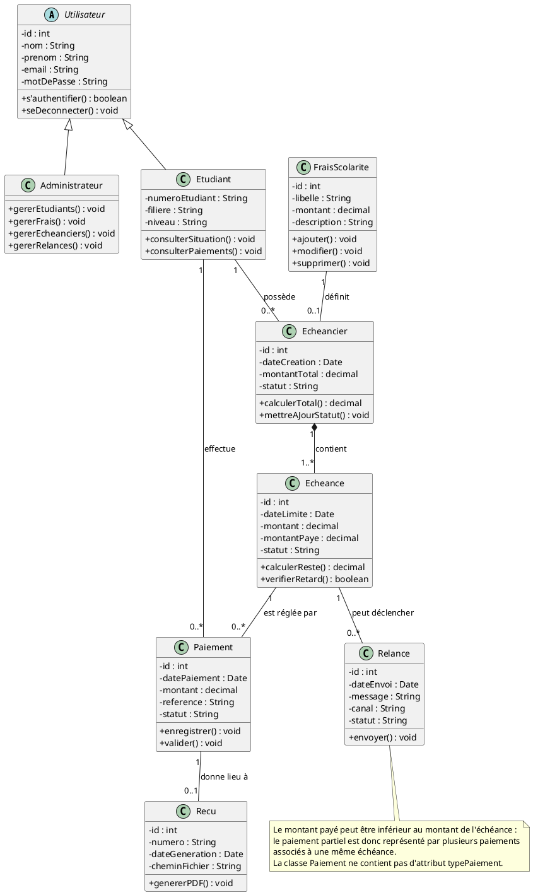

---

# 3. Diagrammes de séquence

## 3.1. Séquence — Authentification

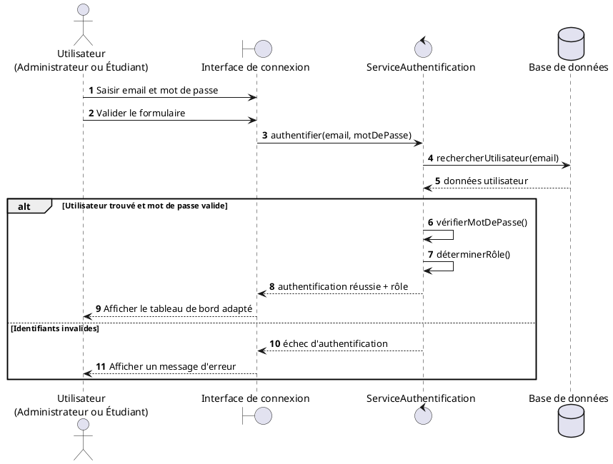

## 3.2. Séquence — Gestion des frais et des échéanciers

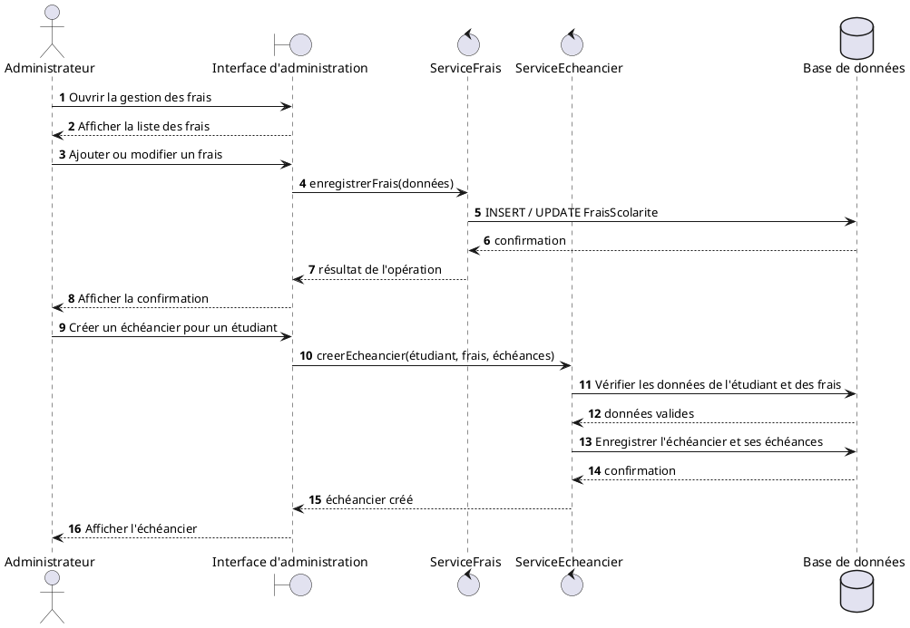

## 3.3. Séquence — Enregistrement d'un paiement

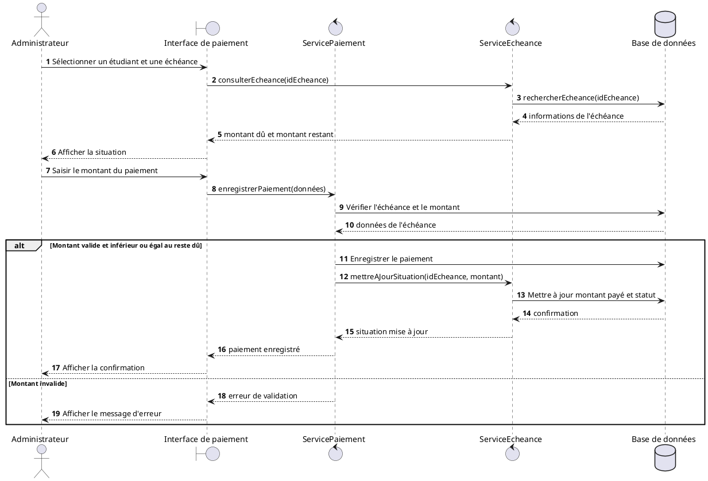

## 3.4. Séquence — Génération d'un reçu

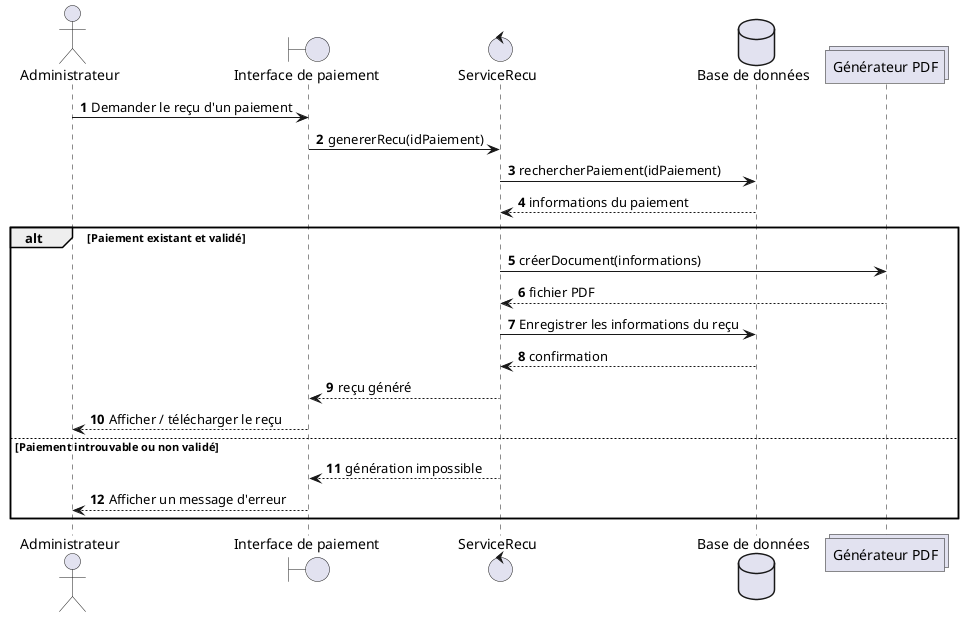

## 3.5. Séquence — Gestion des relances

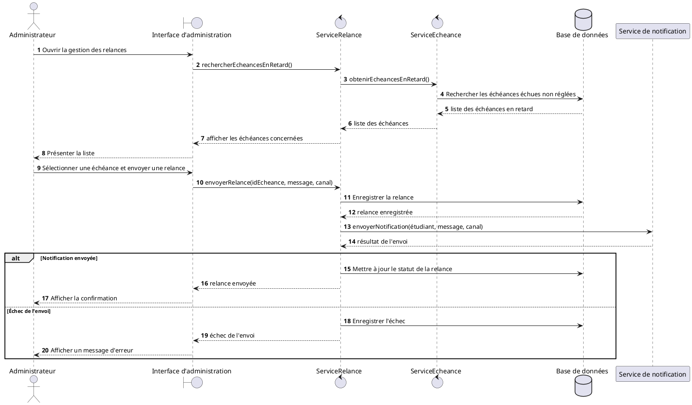

---

# 4. Diagrammes d'activité

## 4.1. Activité — Authentification

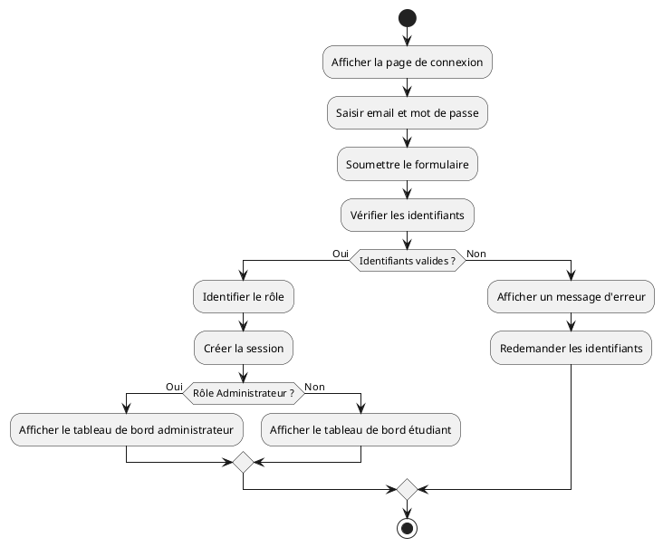

## 4.2. Activité — Gestion des frais et des échéanciers

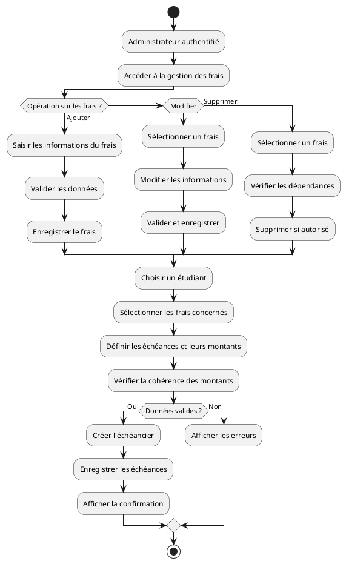

## 4.3. Activité — Processus de paiement

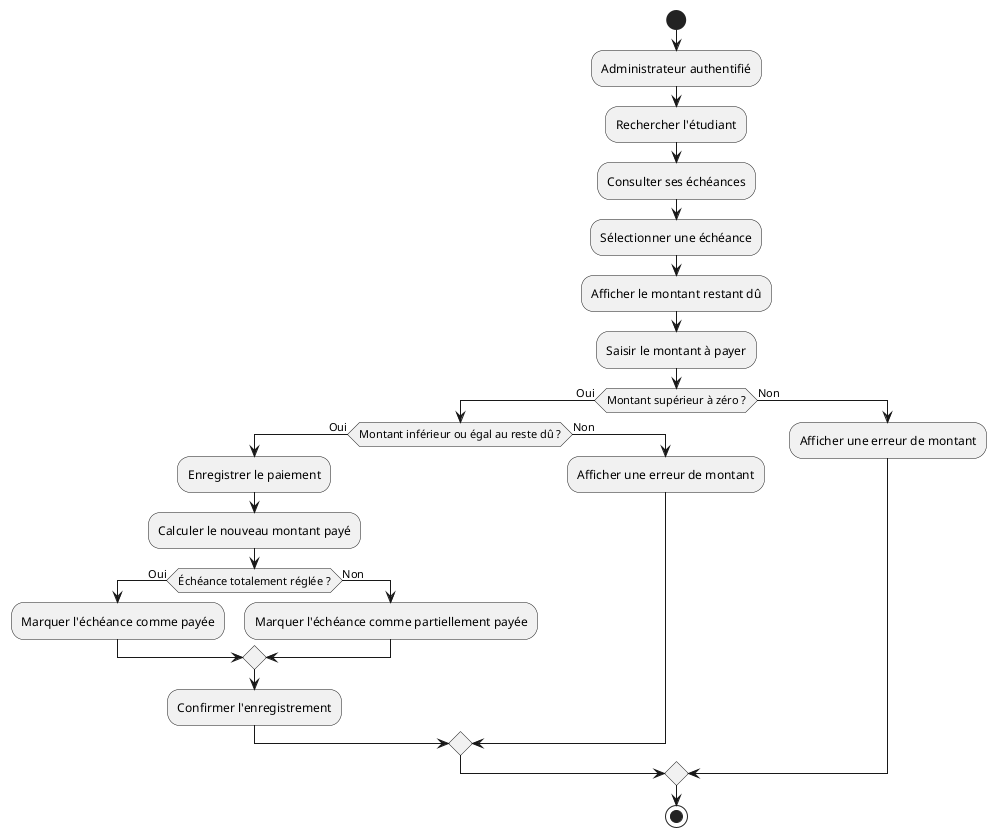

## 4.4. Activité — Génération d'un reçu

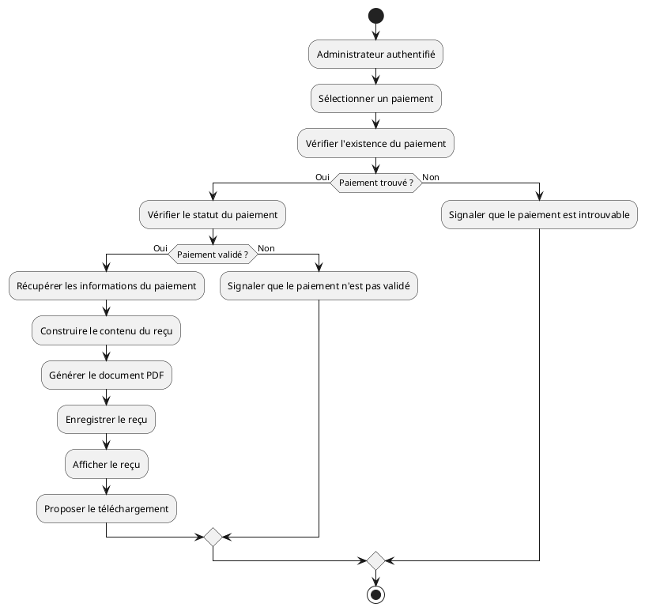

## 4.5. Activité — Processus de relance

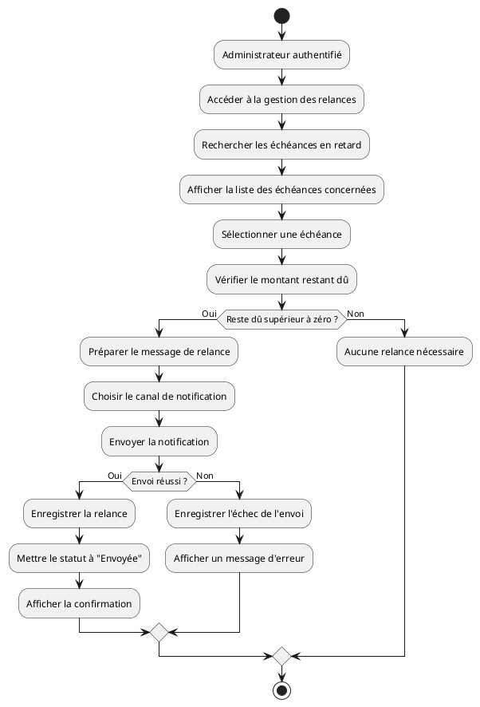

---

# 5. Ordre conseillé pour le rapport

1. Diagramme de cas d'utilisation
2. Diagramme de classes
3. Diagramme de séquence — Authentification
4. Diagramme de séquence — Gestion des frais et des échéanciers
5. Diagramme de séquence — Enregistrement d'un paiement
6. Diagramme de séquence — Génération d'un reçu
7. Diagramme de séquence — Gestion des relances
8. Diagramme d'activité — Authentification
9. Diagramme d'activité — Gestion des frais et des échéanciers
10. Diagramme d'activité — Processus de paiement
11. Diagramme d'activité — Génération d'un reçu
12. Diagramme d'activité — Processus de relance

---

# 6. Points à vérifier avant la remise

- Vérifier que les noms des attributs et des opérations correspondent à l'implémentation finale.
- Vérifier les règles exactes de paiement partiel et de validation d'un paiement.
- Vérifier si l'étudiant peut consulter ou télécharger lui-même ses reçus.
- Vérifier les canaux de relance réellement prévus dans le cahier des charges.
- Conserver la règle d'authentification obligatoire pour les deux acteurs.
- Ne pas réintroduire `typePaiement` dans la classe `Paiement`.

**Note :** les blocs ci-dessus constituent une version cohérente et organisée du code PlantUML à partir des éléments du projet disponibles. Les détails métier non explicitement confirmés doivent être comparés au cahier des charges et aux diagrammes validés par l'enseignant avant la remise finale.
